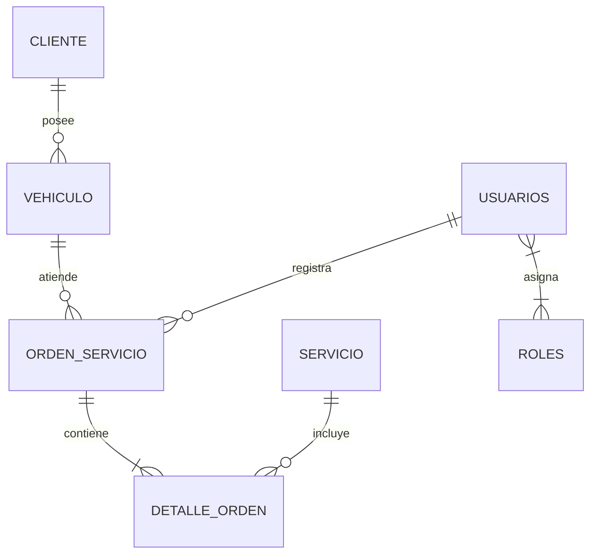

# AutoAndes Backend REST API

Sistema backend empresarial para la gestión integral de órdenes de servicio, catálogo de mantenimiento mecánico, flota vehicular y reportes financieros del taller automotriz **AutoAndes**. Desarrollado con **Java 21**, **Spring Boot 3.4**, **Spring Security 6** con control de acceso basado en roles y permisos (RBAC), persistencia en **Oracle Database 23ai** y documentación interactiva mediante **OpenAPI 3 / Swagger**.

---

## 🏛️ Arquitectura del Sistema

El proyecto sigue una arquitectura en capas desacopladas orientada al dominio empresarial:

```
pe.edu.upeu.autoandes
├── config/                 # Configuraciones globales (CORS, OpenAPI, Security)
├── controller/             # Controladores REST protegidos con @PreAuthorize
├── dto/                    # Data Transfer Objects divididos por módulos (auth, cliente, orden, reporte, servicio, vehiculo)
├── entity/                 # Entidades JPA mapeadas a tablas Oracle 23ai
├── exception/              # GlobalExceptionHandler y excepciones de negocio tipadas (RFC 7807)
├── mapper/                 # Mapeadores de entidad a DTO desacoplados
├── repository/             # Interfaces Spring Data JPA con consultas JPQL aggregate
├── security/               # Filtros JWT, UserDetailsService, JwtService y matriz RBAC
└── service/                # Interfaces de lógica de negocio y sus implementaciones transaccionales (@Transactional)
```

### Diagrama de Relaciones de Entidades (Oracle Database 23ai)



---

## 🛠️ Stack Tecnológico

| Componente | Tecnología | Versión | Propósito |
|---|---|---|---|
| **Lenguaje** | Java OpenJDK | 21 LTS | Runtime de alto rendimiento |
| **Framework Base** | Spring Boot | 3.3.4 / 3.4.x | Núcleo del aplicativo |
| **Persistencia** | Spring Data JPA / Hibernate | 6.5.x | ORM y mapeo relacional |
| **Base de Datos** | Oracle Database Free | 23ai (`FREEPDB1`) | Motor de base de datos relacional |
| **Seguridad** | Spring Security | 6.x | Filtros de autenticación y autorización |
| **Criptografía** | BCrypt / JJWT | 0.12.6 | Hashing de contraseñas y firma de tokens |
| **Documentación** | SpringDoc OpenAPI | 2.6.0 | Swagger UI interactivo |
| **Migraciones** | Flyway | Integrado | Inicialización DDL y datos semilla |
| **Build Tool** | Apache Maven | 3.9+ | Gestión de dependencias del proyecto |

---

## 🔐 Matriz de Seguridad y Control de Acceso (RBAC)

La aplicación utiliza un esquema de **permisos granulares** verificados en cada endpoint mediante `@PreAuthorize("hasAuthority('...')")`. Los roles agrupan conjuntos específicos de permisos:

### Permisos del Sistema

| Permiso | Descripción |
|---|---|
| `SERVICIO_LEER` | Consultar catálogo de servicios disponibles |
| `SERVICIO_ESCRIBIR` | Crear, editar y alternar estado activo/inactivo de servicios |
| `SERVICIO_ELIMINAR` | Eliminación física de servicios no referenciados (RN-01) |
| `VEHICULO_LEER` | Listar vehículos y consultar clientes asociados |
| `VEHICULO_ESCRIBIR` | Crear, editar y eliminar vehículos de la flota (RN-02) |
| `ORDEN_LEER` | Consultar órdenes de servicio registradas y sus detalles |
| `ORDEN_REGISTRAR` | Aperturar nuevas órdenes de servicio mecánicas (RN-03, RN-04) |
| `ORDEN_ANULAR` | Anulación justificada de órdenes el mismo día (RN-05) |
| `REPORTE_VER` | Generación y consulta del consolidado de ingresos por servicio |

### Asignación de Roles y Credenciales de Prueba

Todas las cuentas de prueba están protegidas con el hash BCrypt de la contraseña: **`Auto2026*`**

| Usuario | Contraseña | Rol | Estado | Permisos Asignados |
|---|---|---|---|---|
| **`admin`** | `Auto2026*` | `ROLE_ADMIN` | Activo | Los 9 permisos del sistema (Acceso total) |
| **`asesor`** | `Auto2026*` | `ROLE_ASESOR` | Activo | `SERVICIO_LEER`, `VEHICULO_LEER`, `VEHICULO_ESCRIBIR`, `ORDEN_LEER`, `ORDEN_REGISTRAR` |
| **`jefe`** | `Auto2026*` | `ROLE_JEFE_TALLER` | Activo | `SERVICIO_LEER`, `SERVICIO_ESCRIBIR`, `VEHICULO_LEER`, `ORDEN_LEER`, `ORDEN_ANULAR`, `REPORTE_VER` |
| **`inactivo`** | `Auto2026*` | `ROLE_ASESOR` | **Inactivo** | Cuenta desactivada (Prueba respuesta `401 Unauthorized` uniforme) |

---

## 📑 Catálogo de Endpoints REST

Prefijo base de la API: `/api/v1`

### 1. Autenticación (`/api/v1/auth`)
| Método | Endpoint | Permiso Requerido | Código | Descripción |
|---|---|---|---|---|
| `POST` | `/api/v1/auth/login` | Público | `200` / `401` | Autenticación con credenciales y emisión de token JWT |
| `GET` | `/api/v1/auth/me` | Autenticado | `200` / `401` | Retorna los datos del usuario conectado, roles y permisos |

### 2. Clientes (`/api/v1/clientes`)
| Método | Endpoint | Permiso Requerido | Código | Descripción |
|---|---|---|---|---|
| `GET` | `/api/v1/clientes` | `VEHICULO_LEER` | `200` / `403` | Listado completo de clientes registrados |
| `GET` | `/api/v1/clientes/{id}` | `VEHICULO_LEER` | `200` / `404` | Consulta de cliente por ID |

### 3. Catálogo de Servicios (`/api/v1/servicios`)
| Método | Endpoint | Permiso Requerido | Código | Descripción |
|---|---|---|---|---|
| `GET` | `/api/v1/servicios` | `SERVICIO_LEER` | `200` / `403` | Listado de servicios (parámetro opcional `?soloActivos=true`) |
| `GET` | `/api/v1/servicios/{id}` | `SERVICIO_LEER` | `200` / `404` | Obtener detalle de servicio |
| `POST` | `/api/v1/servicios` | `SERVICIO_ESCRIBIR` | `201` / `400` / `409` | Registro de nuevo servicio (Código único `SRV-000`) |
| `PUT` | `/api/v1/servicios/{id}` | `SERVICIO_ESCRIBIR` | `200` / `400` / `404` / `409` | Actualización de datos del servicio |
| `PATCH` | `/api/v1/servicios/{id}/estado` | `SERVICIO_ESCRIBIR` | `200` / `404` | Alterna el estado activo/inactivo (baja lógica) |
| `DELETE` | `/api/v1/servicios/{id}` | `SERVICIO_ESCRIBIR` | `204` / `404` / `409` | Eliminación física (rechazada si tiene órdenes asociadas: RN-01) |

### 4. Flota de Vehículos (`/api/v1/vehiculos`)
| Método | Endpoint | Permiso Requerido | Código | Descripción |
|---|---|---|---|---|
| `GET` | `/api/v1/vehiculos` | `VEHICULO_LEER` | `200` / `403` | Listado de vehículos (filtro opcional `?clienteId=X`) |
| `GET` | `/api/v1/vehiculos/{id}` | `VEHICULO_LEER` | `200` / `404` | Obtener vehículo por ID |
| `POST` | `/api/v1/vehiculos` | `VEHICULO_ESCRIBIR` | `201` / `400` / `404` / `409` | Alta de vehículo con formato de placa `ABC-123` (RN-02) |
| `PUT` | `/api/v1/vehiculos/{id}` | `VEHICULO_ESCRIBIR` | `200` / `400` / `404` / `409` | Modificación de datos del vehículo |
| `DELETE` | `/api/v1/vehiculos/{id}` | `VEHICULO_ESCRIBIR` | `204` / `404` / `409` | Eliminación física (rechazada si tiene órdenes registradas: RN-02) |

### 5. Órdenes de Servicio (`/api/v1/ordenes`)
| Método | Endpoint | Permiso Requerido | Código | Descripción |
|---|---|---|---|---|
| `POST` | `/api/v1/ordenes` | `ORDEN_REGISTRAR` | `201` / `400` / `404` / `409` | Apertura atómica con cálculo oficial en servidor (RN-03, RN-04) |
| `GET` | `/api/v1/ordenes` | `ORDEN_LEER` | `200` / `403` | Consulta con filtros combinados (`placa`, `estado`, `desde`, `hasta`) |
| `GET` | `/api/v1/ordenes/{id}` | `ORDEN_LEER` | `200` / `404` | Obtener orden completa con sus líneas de detalle |
| `PATCH` | `/api/v1/ordenes/{id}/anular` | `ORDEN_ANULAR` | `200` / `400` / `404` / `409` | Anulación justificada el mismo día con motivo >= 10 chars (RN-05) |

### 6. Reportes Consolidados (`/api/v1/reportes`)
| Método | Endpoint | Permiso Requerido | Código | Descripción |
|---|---|---|---|---|
| `GET` | `/api/v1/reportes/ingresos-por-servicio` | `REPORTE_VER` | `200` / `403` | Agregación JPQL `GROUP BY` excluyendo órdenes `ANULADAS` |

---

## ⚖️ Reglas de Negocio Implementadas

- **RN-01 (Protección de Servicios en Uso):** Un servicio con historial en órdenes de trabajo no puede ser eliminado físicamente de la base de datos (responde `409 Conflict`). Se utiliza la baja lógica (`PATCH /servicios/{id}/estado`).
- **RN-02 (Integridad de Flota Vehicular):** La placa es única nacional (`^[A-Z0-9]{3}-[A-Z0-9]{3}$`), el cliente debe existir (`404 Not Found`), y un vehículo con órdenes registradas no puede ser eliminado físicamente (`409 Conflict`).
- **RN-03 (Consistencia de Cabecera y Detalle):** La orden debe tener entre 1 y 10 líneas, cada ítem con cantidad entre 1 y 5 unidades. No se permite duplicar el mismo servicio en múltiples líneas (`400 Bad Request`). Todos los servicios incluidos deben estar activos (`409 Conflict`). El correlativo autoincremental `OS-000001` es asignado por el servidor.
- **RN-04 (Coherencia de Kilometraje y Cálculo Oficial en Servidor):** El kilometraje no puede ser inferior al de la última orden `REGISTRADA` del mismo vehículo (`409 Conflict`). Los subtotales y el importe total general son calculados estrictamente por el backend a partir del precio de catálogo.
- **RN-05 (Política Estricta de Anulación):** Solo es posible anular órdenes en estado `REGISTRADA` y durante el mismo día calendario de su emisión. Es obligatorio proporcionar un motivo justificado de entre 10 y 200 caracteres (`400 Bad Request` o `409 Conflict`).

---

## 🧪 Pruebas con Postman

Se incluye la colección exhaustiva de pruebas en la ruta:
[`postman/AutoAndes.postman_collection.json`](postman/AutoAndes.postman_collection.json)

Casos cubiertos con aserciones automáticas:
- `200 OK` / `201 Created`: Login exitoso, CRUD completo, generación de orden y reportes.
- `400 Bad Request`: Validaciones de formato (placa inválida, código de servicio mal formado, detalle vacío, motivo de anulación menor a 10 caracteres).
- `401 Unauthorized`: Credenciales erróneas o token JWT inválido/expirado.
- `403 Forbidden`: Acceso a operaciones sin el permiso granular requerido (e.g. Asesor intentando anular una orden o acceder a reportes).
- `404 Not Found`: Consulta o asociación a recursos inexistentes.
- `409 Conflict`: Violaciones de reglas de negocio RN-01 a RN-05.

---

## 🚀 Despliegue y Ejecución Local

### Prerrequisitos
- JDK 21 instalado y configurado en `JAVA_HOME`.
- Oracle Database 23ai Free ejecutándose en `localhost:1522/FREEPDB1`.
- Usuario de base de datos `autoandes` con contraseña `123456`.

### Pasos de Ejecución
```bash
# 1. Posicionarse en la carpeta del backend
cd autoandes-backend

# 2. Compilar el proyecto verificando dependencias
./mvnw clean compile

# 3. Iniciar la aplicación
./mvnw spring-boot:run
```

La API estará lista para recibir peticiones en:
- API Base: `http://localhost:8080/api/v1`
- Swagger UI interactivo: `http://localhost:8080/swagger-ui.html`
- OpenAPI JSON Spec: `http://localhost:8080/v3/api-docs`

---

## 🌿 Estrategia de Versionamiento (Git Flow)

El proyecto implementa Git Flow con convenciones de **Conventional Commits**:
- `main`: Código probado y estable en producción con etiquetas semánticas (`v1.0-examen-u2`).
- `develop`: Rama central de integración.
- `examen-a-gamarra`: Rama de desarrollo de funcionalidades y casos prácticos.
